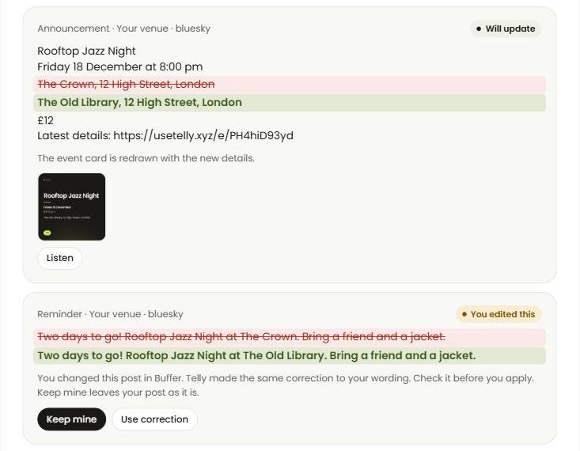
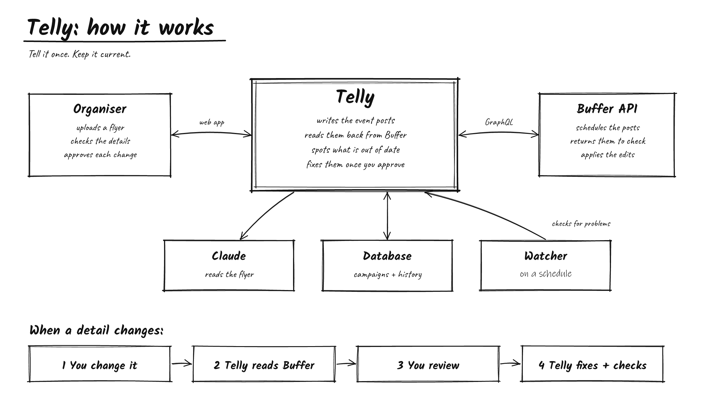

# Telly

**Tell it once. Keep it current.**

Telly schedules the posts for an event in Buffer, and keeps them right when plans change.

**Try it:** [usetelly.xyz](https://usetelly.xyz) · [the demo](https://usetelly.xyz/demo) needs no account and runs on a practice queue.

Built for [Buffer Commit](https://buffer.com/api/commit).

## See it in 60 seconds

1. Open [usetelly.xyz/demo](https://usetelly.xyz/demo). No account is needed, and nothing is posted anywhere.
2. Press **Try a sample event**. Telly schedules an announcement, a reminder and a day-of post on two practice channels, and the reminder is then edited by hand, as someone might in Buffer.
3. A change is already typed into **Tell Telly what changed**. Press **Show the changes**.
4. Check the review: old lines crossed out, the event card redrawn, and the hand-edited post waiting for you to choose **Keep mine** or **Use correction**. Press **Apply**.
5. Open the event page from the campaign. It shows the new details.

## The problem

The venue moves, or the start time slips, and three posts are already scheduled with the old details. You dig through the queue, fix one, forget another, and someone turns up at the wrong place.



Change a detail once. Telly reads each post back from Buffer, shows what would change, and sends nothing until you approve it. If you rewrote a post yourself in Buffer, it notices and asks whether to keep your wording.

## What it does

- **Three posts from one event:** an announcement, a reminder and a day-of post, timed in the event's own time zone.
- **A picture with alt text:** an event card drawn from the details, or your own flyer.
- **Changes in plain words:** type "moved to Friday at 8, same place" and check the edit Telly proposes.
- **Event status:** sold out, postponed or cancelled. Cancelling takes unpublished posts out of the queue.
- **Posts already sent:** Telly suggests follow-up wording.
- **History and undo** for changes that haven't gone out.
- **An event page** that always shows the latest details, with a calendar entry that updates itself.
- **Watching:** occasional background checks, on a schedule, for posts that failed or a paused queue. Email alerts are sent when a Resend key is configured.
- **Team use:** campaigns are shared within a Buffer organization.
- **Save to Buffer:** posts as ideas, and details as a snippet on Buffer plans that include snippets.
- **Repeat events** and a **Listen** button to hear a post before it goes out.

## How it works



Claude also turns a plain-words change into edited event details. The organiser checks the result either way.

## Using the Buffer API

| Operation | What Telly uses it for |
|---|---|
| OAuth 2.0 with PKCE | Sign-in, with rotating refresh tokens |
| `account`, `channels` | Choosing the organization and where to post |
| `createPost` | Scheduling each post at a custom time, with image and alt text |
| `post` | Reading posts back, up to 25 in one request using aliases |
| `editPost` | Correcting text and images; the time changes only when the event's time did |
| `deletePost` | Cancelling and postponing |
| `createIdea` | Saving wording for channels Telly doesn't schedule |
| `createSnippet`, `updateSnippet` | Keeping the event details in one reusable block |

What we do so a change can be trusted:

- **Read back after writing.** After an edit, Telly asks Buffer for the post again and counts it as updated only when the text, time and alt text match what was sent. A deletion counts only when the post is gone.
- **Never overwrite silently.** Hand edits made in Buffer are detected and need a decision.
- **No blind retries.** A read is retried once after a dropped connection; a write isn't, so a lost reply can't post twice.
- **Careful with limits.** Batched reads, `Retry-After` honoured, and watched accounts checked on a schedule instead of constantly.
- **Deleted posts are normal.** If every requested post is gone, Buffer returns no data; Telly treats that as "deleted" rather than an error.

The queries are in [`lib/queries.js`](lib/queries.js) and the client in [`lib/buffer.js`](lib/buffer.js).

## Security and privacy

- Sign-in tokens live in an encrypted cookie. If you turn watching on, they are stored encrypted (AES-256-GCM) in the database so checks can run while you're away, and removed when you turn it off.
- Event card addresses are signed, so nobody can use Telly to draw arbitrary images.
- A strict Content Security Policy, and no analytics or tracking cookies.
- One button deletes your Telly data. Posts already in Buffer stay there. See the [privacy page](https://usetelly.xyz/privacy).

## Run it locally

Needs Node 22 or newer.

```bash
npm install
cp .env.example .env
npm run certs
npm start
```

Open `https://localhost:3000/demo` and accept the self-signed certificate. The demo needs no keys.

To connect a real Buffer account, create an app client in Buffer (Settings → API → App Clients), add `https://localhost:3000/callback` as a redirect URL, and put the client ID and secret in `.env`.

| Setting | Needed for |
|---|---|
| `BUFFER_CLIENT_ID`, `BUFFER_CLIENT_SECRET` | Signing in with Buffer |
| `REDIRECT_URI` | Must match the app client exactly |
| `SESSION_SECRET` | Required in production, 32+ characters |
| `DATABASE_URL` | Postgres. Without it, local runs use JSON files |
| `ANTHROPIC_API_KEY` | Optional: flyer reading and plain-words changes |
| `TOKEN_KEY`, `CRON_SECRET` | Optional: watching |
| `RESEND_API_KEY` | Optional: watching emails |
| `TELLY_IDEAS=1` | Optional: Save to Buffer (the app client needs the ideas and snippets permissions) |

## Tests

```bash
npm test
npm run e2e
```

Unit tests cover the writing, change planning, undo and security rules. The end-to-end checks run a local Telly against a fake Buffer ([`scripts/mock-buffer.js`](scripts/mock-buffer.js)), and CI runs both on every push. The fake only tests Telly's own logic, so the main flows were also checked against the real Buffer API.

## Layout

```
lib/          server: Buffer client, campaign logic, routes, cards, event pages, watching
public/       the web app (plain HTML, CSS and JavaScript, no build step)
test/, e2e/   unit tests and end-to-end flows
scripts/      fake Buffer, local certificate, database migration
```
